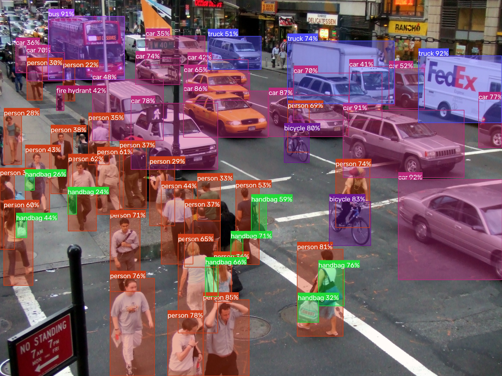

# ONNX YOLOv8 Object Detection


*Original image: [https://www.flickr.com/photos/nicolelee/19041780](https://www.flickr.com/photos/nicolelee/19041780)*

> 📖 **Need a complete terminal guide?**  
> Check out **[HOW_TO_RUN.md](HOW_TO_RUN.md)** for a dedicated, step-by-step terminal execution walkthrough with copyable commands for macOS, Linux, and Windows.

---

## Important Note
The input images are directly resized to match the model's input dimensions (`480x640`). Letterbox padding is skipped, which may slightly affect accuracy if your input image has an aspect ratio significantly different from `480x640`. For optimal performance, use input images with a similar aspect ratio.

---

## Requirements

* Python 3.8+
* Check [requirements.txt](requirements.txt) for dependencies.
* For ONNX Runtime:
  * **macOS / CPU**: `onnxruntime` is installed automatically.
  * **Linux / Windows with NVIDIA GPU**: `onnxruntime-gpu` is installed automatically for CUDA acceleration.

---

## Installation & Quick Start

### 1. Clone the Repository
```bash
git clone https://github.com/sukrut07/ObjectDetection-YOLOV8.git
cd ObjectDetection-YOLOV8
```

### 2. Create and Activate a Virtual Environment

**macOS / Linux:**
```bash
python3 -m venv .venv
source .venv/bin/activate
```

**Windows (PowerShell):**
```powershell
python -m venv .venv
.venv\Scripts\Activate.ps1
```

**Windows (Command Prompt):**
```cmd
python -m venv .venv
.venv\Scripts\activate.bat
```

### 3. Install Dependencies
```bash
pip install --upgrade pip
pip install -r requirements.txt
```

---

## ONNX Model Preparation

The detection scripts load the ONNX model from `models/yolov8m.onnx`.

### Convert / Export Model (Copyable Commands)

1. Install Ultralytics:
```bash
pip install ultralytics
```

2. Export `yolov8m.pt` to ONNX format (input size: 480x640):
```bash
yolo export model=yolov8m.pt format=onnx imgsz=480,640
```

3. Move the exported model into the `models/` directory:
```bash
mkdir -p models && mv yolov8m.onnx models/
```

*(On Windows CMD/PowerShell, replace with `mkdir models` and `move yolov8m.onnx models\`)*

### Python One-Liner Alternative:
```bash
python -c "from ultralytics import YOLO; YOLO('yolov8m.pt').export(format='onnx', imgsz=[480, 640])" && mkdir -p models && mv yolov8m.onnx models/
```

### Google Colab Notebook:
Convert and download via Colab: [](https://colab.research.google.com/drive/1-yZg6hFg27uCPSycRCRtyezHhq_VAHxQ?usp=sharing)

---

## How to Run

Ensure your virtual environment is active before running these commands:

### 1. Image Object Detection
Runs inference on a sample image URL, displays bounding boxes, and saves the result to `doc/img/detected_objects.jpg`:
```bash
python image_object_detection.py
```
*Press **any key** on the OpenCV image window to close it.*

### 2. Webcam Real-Time Object Detection
Streams real-time detection from your local webcam:
```bash
python webcam_object_detection.py
```
*Press **`q`** while focused on the window to exit.*

### 3. Video Object Detection (YouTube / Local MP4)
Streams a YouTube video (at 720p) and runs real-time object detection:
```bash
python video_object_detection.py
```
*Press **`q`** while focused on the window to exit.*

  
*Original video: [https://youtu.be/Snyg0RqpVxY](https://youtu.be/Snyg0RqpVxY)*

---

## Original YOLOv8 Model & Licensing
* Original YOLOv8 model repository: [Ultralytics YOLOv8](https://github.com/ultralytics/ultralytics)
* YOLOv8 model weights license: [GPL-3.0 License](https://github.com/ultralytics/ultralytics/blob/main/LICENSE)
* Source repository upstream: [ibaiGorordo/ONNX-YOLOv8-Object-Detection](https://github.com/ibaiGorordo/ONNX-YOLOv8-Object-Detection)

---

## References
* YOLOv8: [https://github.com/ultralytics/ultralytics](https://github.com/ultralytics/ultralytics)
* YOLOv5: [https://github.com/ultralytics/yolov5](https://github.com/ultralytics/yolov5)
* YOLOv6: [https://github.com/meituan/YOLOv6](https://github.com/meituan/YOLOv6)
* YOLOv7: [https://github.com/WongKinYiu/yolov7](https://github.com/WongKinYiu/yolov7)
* PINTO0309's Model Zoo: [https://github.com/PINTO0309/PINTO_model_zoo](https://github.com/PINTO0309/PINTO_model_zoo)
* PINTO0309's Model Conversion Tool: [https://github.com/PINTO0309/openvino2tensorflow](https://github.com/PINTO0309/openvino2tensorflow)
